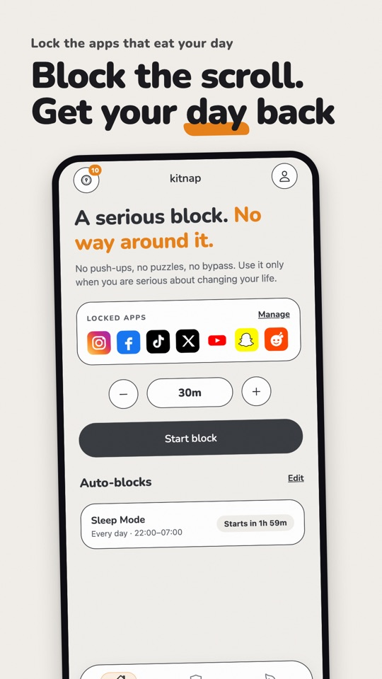
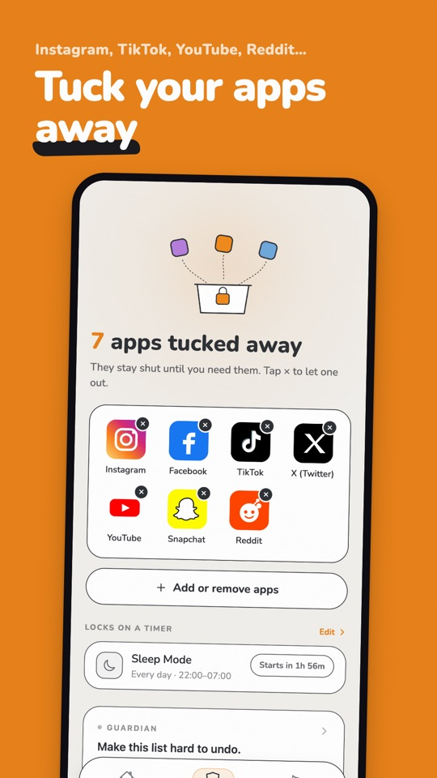
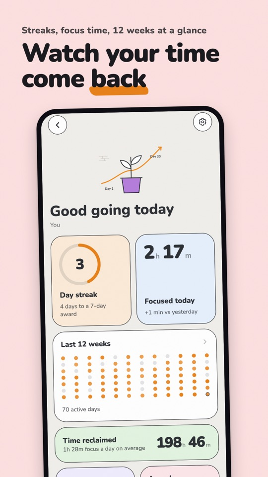
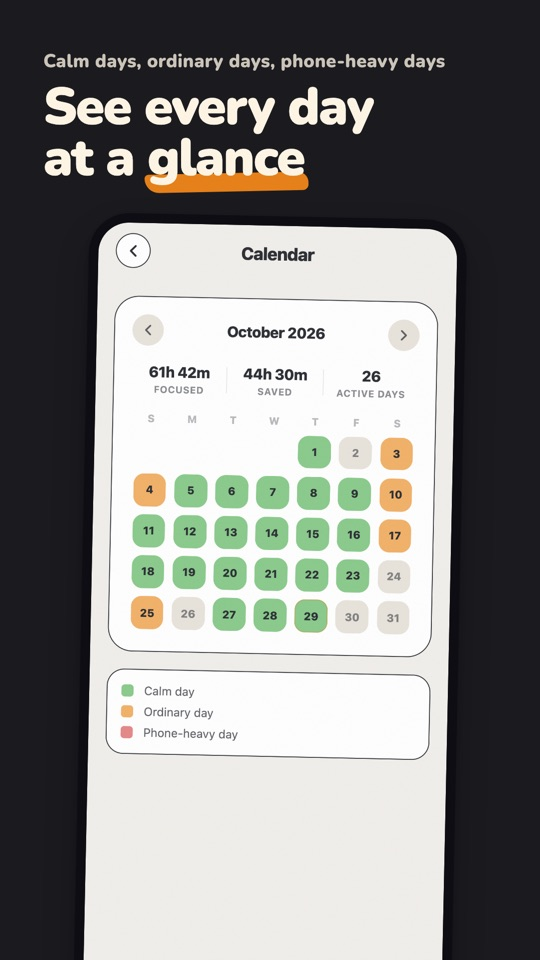
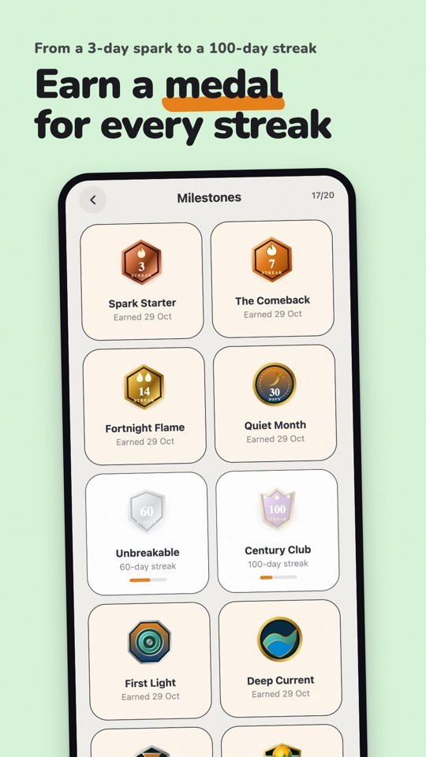
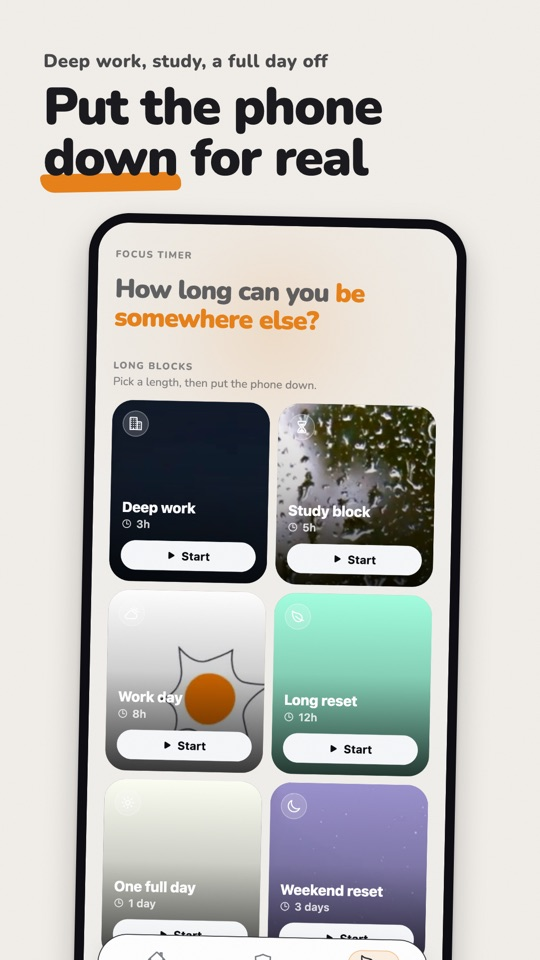
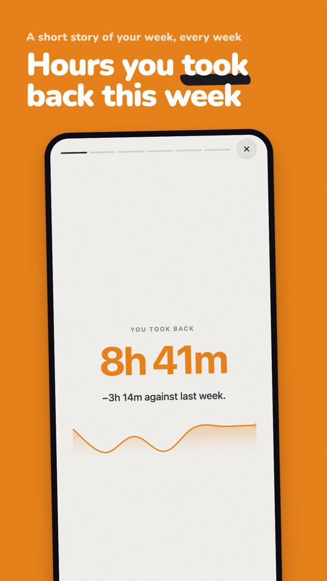

<div align="center">


# Kitnap — App Blocker & Focus

**A calm, honest screen-time blocker for Android and iOS.**

Block the apps that pull you in, run focus sessions that can't be quietly cancelled,
and see where your time actually goes — with no backend and no tracking.

[](https://github.com/aby050/kitnap/actions/workflows/ci.yml)
[](LICENSE)


[](CONTRIBUTING.md)

[Website](https://kitnap.rvastudio.in) · [Privacy](https://kitnap.rvastudio.in/privacy) · [Terms](https://kitnap.rvastudio.in/terms)

[](https://play.google.com/store/apps/details?id=com.abhay.byre)

</div>

## Screenshots

<p align="center">
  
  
  
  
  
  
  
</p>

---

## Features

- **Real app blocking.** An Android Accessibility Service detects blocked apps and raises a shield;
  on iOS the Screen Time API (FamilyControls, ManagedSettings, DeviceActivity) does the same natively.
- **Focus sessions that hold.** Once a timed session starts, the only way out early is an
  emergency bailout key — not a hidden cancel button.
- **Schedules, bedtime and app limits.** Recurring blocks and daily limits, enforced on-device.
- **Guardian mode.** Hand a one-time code to someone you trust; loosening your rules then needs them.
- **Real usage, not self-reports.** Reads Android usage stats and the iOS `DeviceActivityReport`
  extension to show your actual screen time, weekly stories and a time ledger.
- **Ambience.** Optional sounds and looping video backdrops for sessions.
- **Progress.** Streaks, milestones and seasons that reward time kept, not time spent.
- **Local-first.** No server: settings and history stay on the device. Purchases go through
  the App Store / Google Play via RevenueCat.

## Tech stack

| Area | Choice |
|---|---|
| Framework | Expo SDK 57, React Native 0.86 (New Architecture), React 19, TypeScript (strict) |
| Navigation | React Navigation (native stack) |
| Storage | MMKV, AsyncStorage |
| Animation & graphics | Reanimated, react-native-svg, expo-video |
| iOS native | App extensions in [`targets/`](targets): `ShieldConfiguration`, `ShieldAction`, `ActivityMonitorExtension`, `UsageReport`, `livetimer` (Live Activity) |
| Android native | Accessibility service and usage-stats access via local Expo modules in [`modules/`](modules) and config plugins in [`plugins/`](plugins) |
| Payments | RevenueCat (`react-native-purchases`) |

## Getting started

### Prerequisites

- Node.js 20+ and npm
- **iOS:** macOS with Xcode 26+, CocoaPods. Screen Time APIs need a real device and the
  Family Controls entitlement for distribution.
- **Android:** JDK 17 and the Android SDK (platform 36). Blocking needs a real device or an
  emulator with Accessibility enabled.

Kitnap uses native modules, so it runs in a **development build**, not Expo Go.

### Setup

```bash
git clone https://github.com/aby050/kitnap.git
cd kitnap
npm install
cp .env.example .env     # optional: RevenueCat public keys, Google Sign-In client id
```

### Run

```bash
npm run android          # expo run:android
npm run ios              # prebuild + ExtensionKit patch + expo run:ios
npm run web              # UI preview in the browser (native features stubbed)
```

The web preview accepts `?demo=1` to load sample data, which is handy for UI work.

> **Note on iOS prebuild.** `npm run ios` runs `scripts/fix-extensionkit.js` after
> `expo prebuild`. If you run prebuild yourself, run that script too, or the install fails with
> `AppexBundleMissingNSExtensionDict`.

### Type-check

```bash
npx tsc --noEmit
```

## Project structure

```
App.tsx                 app root, navigation and providers
src/
  main/                 tab screens: home, timer, blocks, world, settings, account
  onboarding/           first-run flow, permissions, paywall
  shield/               the screen shown over a blocked app
  data/                 state, enforcement (schedules, limits, bedtime), purchases
  components/ ui/ design/  shared UI and design tokens
  world/                landmarks and progress world
modules/                local Expo modules (device permissions, usage report, live timer)
targets/                iOS app extensions (Screen Time shield, monitor, report, Live Activity)
plugins/                Expo config plugins for native setup
scripts/                build, store-listing and asset tooling
notes/DECISIONS.md      settled technical decisions and the alternatives that were rejected
```

## Contributing

Bug reports, fixes and improvements are welcome. Please read [CONTRIBUTING.md](CONTRIBUTING.md)
first — in particular, check [`notes/DECISIONS.md`](notes/DECISIONS.md) before proposing a change
to something that was settled deliberately. Report security issues privately as described in
[SECURITY.md](SECURITY.md).

## License

Kitnap is **source-available** under the [PolyForm Noncommercial License 1.0.0](LICENSE).
You may read, run, modify and share the code for any noncommercial purpose, and contributions
are welcome. Commercial use — including publishing the app or a derivative to an app store —
is not permitted without written permission.

The Kitnap name, logo, mascot and artwork are not covered by the code license.

© 2026 Abhay Bundela / RVA Studio
